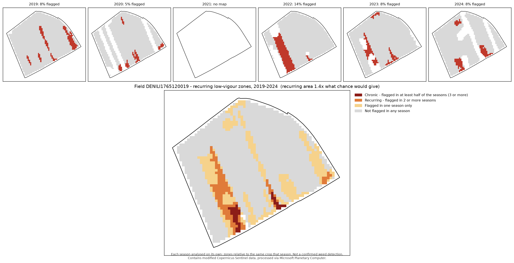

# Precision Weed Scouting — where to look first, from Sentinel-2

[](https://github.com/field-intelligence-platform/Precision-Weed-Detection-and-Targeted-Spraying/actions/workflows/tests.yml)
[](https://github.com/field-intelligence-platform/Precision-Weed-Detection-and-Targeted-Spraying/releases/latest)
[](LICENSE)

Python ≥ 3.10 · Windows, macOS, Linux · free data only (Sentinel-2 via Microsoft Planetary Computer, no account or API key) · open source

Give it a field-boundary file and a year. It returns a map of the zones that **underperformed the rest of their own crop on most clear-sky dates**, so a farmer, agronomist or drone knows where to walk first.

It is a **scouting map, not a weed detector.** Sentinel-2 pixels are 10 m wide, so individual weeds and most weed patches are not visible from orbit. Low vigour can come from weeds, but equally from waterlogging, compaction, nutrient deficiency, pests or poor emergence. Every output says this, and each zone carries the evidence behind it ("flagged on 8 of 9 clear dates"). Actual weed detection is the job of v2, a segmentation model on drone imagery (see [Roadmap](#roadmap)).

> **Status: tested on satellite data, not yet checked in the field.** The method finds 79–81 % of simulated weak
> patches on 28 fields across Germany it was never tuned on, flags at most 0.1 % of a field by chance, and its zones are repeatable
> ([how far it has been tested](#how-far-it-has-been-tested)). Whether the zones it finds are weeds or another problem
> has **not been checked on the ground yet**. That field check is the next step, and you can help ([see below](#help-us-check-it-in-the-field)).
> Until then, treat the map as a prioritised list of places to look, not as findings.

| You give it | You get, per field | Time and cost |
|---|---|---|
| A boundary file you already have (Shapefile, GeoJSON, KML/KMZ, GPX, GeoPackage) and a year | A scouting map, zones as GeoJSON/Shapefile for farm software, a plain-language summary, and with the visit kit GPS points for a field visit | About 1–2 minutes for a few fields; free |


*Field block DENILI1765120019 near Göttingen, 2024 season. The block holds two crops (U1 winter cereal, U2 summer crop), and each is compared only with itself, in its own growing period. Red marks a persistent low-vigour zone inside a crop. Purple marks pixels whose seasonal curve follows neither crop (including mixed pixels where the two crops meet), so they are shown but not scored. Blank areas inside the field are crop-unit borders and pixels whose crop could not be determined with confidence.*

## Why you can trust what it says – and where it stops

You don't have to take our word for it. Everything below can be checked, and the commands to repeat every test are in
[docs/VALIDATION.md](docs/VALIDATION.md).

- **Tested against a known answer.** Weak patches were planted into the *real* Sentinel-2 series of real fields, so
  the right answer was known in advance. On the calibration fields it found **92–100 %** of planted patches of
  0.25–1 ha that were 10–20 % weaker than their crop (and 96–100 % of those at least 15 % weaker).
- **Tested on fields it had never seen:** 28 fields in 7 regions of Germany, two seasons: **79–81 %** of the same
  kind of patches found.
- **It does not invent zones.** When the data is shuffled so that only chance could line up a zone, it flags at most
  **0.1 %** of a field.
- **Its settings were not tuned to look good.** Thresholds were chosen by a fixed rule written down in advance and then
  checked on new data. Twice, a setting that looked better on the calibration fields was rejected because it
  over-flagged new ones.
- **Every zone shows its evidence:** on how many clear dates it was weaker, and by how much ("weaker on 8 of 10 dates,
  about 12 % below its crop"). A zone with thin evidence looks thin.
- **It refuses rather than guesses.** With fewer than 3 usable images for a crop, it makes no map and says why.

**Where it stops:** it cannot see individual weeds or patches much smaller than 0.25 ha (10 m pixels), and it cannot
tell *why* a spot is weak. Whether its zones are weeds, waterlogging, compaction or something else has **not been
checked in the field yet**. Practical tips: [Before you use the map](#before-you-use-the-map); every known limit in
detail: [docs/VALIDATION.md](docs/VALIDATION.md#known-limits).

### Help us check it in the field

The one thing satellite tests cannot prove is what the zones *are*. If you farm or advise farmers: run weedscout on a
field you know well and tell us whether the zones match the places you know, good or bad. The
[field-visit kit](#field-visit-kit) makes a proper check easy: it adds hidden control points, so a hit rate can be
compared with chance. Share what you find in [Discussions](https://github.com/field-intelligence-platform/Precision-Weed-Detection-and-Targeted-Spraying/discussions).

## Example results (3 official field blocks near Göttingen, 2024 season)

| Field block | Area | Crop units | Usable dates per crop | Scout first | of which at field edge | Unusual pattern (not scored) | Flagged share |
|---|---|---|---|---|---|---|---|
| [DENILI0465750023](outputs/example/DENILI0465750023/summary.md) | 15.7 ha | 1 | 14 | 0.49 ha (3 zones) | 3 | – | 3.5 % |
| [DENILI1765120019](outputs/example/DENILI1765120019/summary.md) | 22.7 ha | 2 | 10 / 20 | 0.63 ha (1 zone) | 1 | 1.96 ha | 4.1 % |
| [DENILI0565200005](outputs/example/DENILI0565200005/summary.md) | 37.5 ha | 3 | 21 / 14 / 11 | 0.67 ha (1 zone) | 1 | 0.68 ha | 2.2 % |

**All 5 Scout-first zones touch the field edge.** On these fields, the strongest persistent signal is the headland, where compaction from turning machinery, hedge shading and overlaps are common. That is real agronomic information, but it is mostly not weeds. If you only want in-crop zones, run with `--edge-buffer-m 20` to leave a wider strip along the edge out of the analysis.

Each summary also says **how weak a problem can be and still be seen on that crop**. For example, U1 of field 1765 is patchy enough that problems weaker than about 12 % cannot be told apart from its natural variation, while on the other crops the limit is 5 %.

**Not yet validated on the ground.** These zones have not been visited. Until they are, treat the tiers as a prioritised list of places to check, not as findings. The tool generates a [blind field-visit kit](#field-visit-kit) for exactly that.

Maps for the other two fields: [DENILI0565200005](outputs/example/DENILI0565200005/quicklook.png) (three crop units, including a separately sown plot) · [DENILI0465750023](outputs/example/DENILI0465750023/quicklook.png) (one uniform crop; only headland zones flagged).

## How far it has been tested

Full details and reproduction commands: [docs/VALIDATION.md](docs/VALIDATION.md).

| Question | Test | Result |
|---|---|---|
| Does it find a real weak patch? | Weak patches injected into the real 2024 and 2023 Sentinel-2 series of each field | ≥ 0.25 ha patches with a ≥ 15 % NDVI deficit: 96–100 % found as Scout first. 0.1 ha patches: not found |
| Does it flag noise? | Anomaly maps shifted at random so that only chance can line up a zone | 0 % of field area flagged |
| Does it flag too much of a real field? | Share of each real field flagged | ≤ 4.1 % (2024), ≤ 7.5 % (2023) |
| Were the thresholds tuned to fit? | Chosen by a fixed rule, then checked on new fields | Twice a more sensitive setting looked best on the calibration fields and was rejected because it over-flagged new data |
| Are the zones repeatable? | Season split into two independent halves of dates | 71–100 % of Scout-first area found again (chance: 3–15 %) |
| Same zones every year? | 2019–2024, each season on its own | Not shown on these fields: recurring area about what chance gives |
| Is the crop-unit split stable? | Whole split repeated with 5 different random seed sets | 0 %, 2 % and 0 % of pixels scored differently |
| **Does it work on fields it was not tuned on?** | Same tests on 28 new fields in 7 regions of Germany | **79–81 %** of patches found; chance false alarms ≤ 0.1 %; 27–28 of 28 fields mapped. Weakest on naturally patchy sandy soil (Fläming, 38–56 %). One field was 38 % flagged because of a later-sown strip |
| Does it work on a clean machine? | CI: fresh install and full test suite | Linux, Windows, macOS × Python 3.10–3.13 |
| **Are the zones actually weeds?** | **Field visit** | **Not done yet** |

## Project status

| | Status |
|---|---|
| Installs and passes all tests on a clean machine (CI) | ✅ Done |
| Thresholds chosen by a stated rule on real data, checked on a held-out season | ✅ Done |
| Zones repeatable across independent images | ✅ Done |
| Crop-unit split stable across repeated runs | ✅ Done |
| Blind field-visit kit with control points | ✅ Ready to use |
| **Ground-truth visit** (are the zones really weeds or another problem?) | ⏳ Open: needs a visit in a growing season |
| Tested beyond the calibration fields | ✅ 28 fields, 7 regions, 2 seasons: out-of-sample recall 79–81 % |
| Multi-year view: which zones recur across seasons | ✅ Done (`weedscout-history`) |
| Each crop scored in its own growing period (cereals in spring, maize in summer) | ✅ Done: whole-season window by default |
| Detection limit stated per crop, from that crop's own patchiness | ✅ Done |
| Large zones flagged as a possible management difference (e.g. sown later) | ✅ Done |
| Telling a deliberately later-sown strip from poor emergence | ➖ Not possible from satellite data; needs the farmer's records |
| Satellite weed *detection* | ➖ Not possible at 10 m; planned as v2 on drone imagery |

## Quick start

New to Python or setting up a new computer? [INSTALL.md](INSTALL.md) walks through every step, with troubleshooting.

```bash
git clone https://github.com/field-intelligence-platform/Precision-Weed-Detection-and-Targeted-Spraying.git
cd Precision-Weed-Detection-and-Targeted-Spraying
python -m venv .venv && source .venv/bin/activate      # Windows: .venv\Scripts\activate
pip install -e ".[dev]"

weedscout --boundary data/fields/goettingen_example_fields.geojson --year 2024 --out outputs/my_run
pytest                                                   # offline tests, no network needed
```

No API key is needed: imagery comes from the free [Microsoft Planetary Computer](https://planetarycomputer.microsoft.com/) STAC API. A run over three fields and one season takes one to two minutes. The command above reproduces the committed example in [`outputs/example/`](outputs/example/).

### Using it in the current season

`--year` works for the season that is still running (for example `--year 2026` in July): it uses every clear image so
far. Two things to know:

- **The map needs enough clear images of each crop.** At least 3 are required, otherwise there is no map for that
  crop. The more clear dates, the firmer the map: the example fields had 10–21 per crop over the whole 2024 season.
- **Each crop is scored in its own growing period.** A winter cereal is judged on its spring growth, so its map becomes
  useful from about early summer; maize grows later, so its map follows in late summer. Running it again later in the
  season adds the new images.

### Command-line options

| Option | Default | Meaning |
|---|---|---|
| `--boundary` | required | boundary file; every feature is one field |
| `--year` | – | **recommended:** the whole growing season of that year (1 March – 31 October). Each crop is scored only in its own growing period, so cereals and maize are both handled in one run |
| `--start`, `--end` | – | a custom window (`YYYY-MM-DD`) instead of `--year`. Keep it wide: bare-soil and post-harvest dates are what separate crops into units |
| `--out` | `outputs` | output folder; one sub-folder per field |
| `--id-column` | auto | attribute holding the field id (auto, first found: `field_id`, `flik`, `name`/`Name`/`NAME`, `id`) |
| `--min-zone-ha` | `0.1` | smallest zone that is reported |
| `--edge-buffer-m` | `10` | strip along the field edge left out of the analysis; `20` also leaves out most headland effects |
| `--max-tile-cloud` | `80` | loose pre-filter on whole-tile cloud cover; the field itself is checked pixel by pixel |
| `-v` | off | verbose logging |

Exit code `0` = all fields mapped, `1` = at least one field had too few usable dates, `2` = the boundary file could not be used.

### Field-visit kit

```bash
weedscout-visit-kit outputs/my_run                  # writes outputs/my_run/visit_kit/
weedscout-score-visits outputs/my_run/visit_kit     # after the visit
```

The kit writes one GPS point per zone plus **blind control points** in Normal areas. All points are shuffled and named P01, P02 … so the visitor cannot tell which is which. You get `points.gpx` for a phone GPS app, a `record_sheet.csv` to fill in (weeds none / few / many, other cause, notes, photo), short visit instructions, and a separate answer key. Scoring then reports how often each tier really had a problem **compared with the controls**. A hit rate means nothing without that comparison.

### Multi-year view (optional)

Most of the time you only need the current season. The multi-year view answers one extra question: **does a zone come
back every year?** A spot that returns season after season (a wet hollow, compaction, a perennial weed like thistle)
needs a lasting fix rather than a one-off treatment.

```bash
weedscout-history --boundary data/fields/goettingen_example_fields.geojson --years 2019-2024 --out outputs/history
```

Each season uses the whole growing season (`--season 03-01:10-31` by default).

Each season is analysed on its own, and per pixel the tool counts **in how many seasons it was flagged**: *flagged once*, *recurring* (2 or more seasons) or *chronic* (at least half of the seasons, 3 or more). A zone that comes back year after year points to a lasting cause, such as a wet hollow, compaction or a perennial weed patch, and deserves more attention than a one-season blip.

Some overlap between years happens by chance, so every result is compared with the recurring area **expected if each season's zones were placed independently**:

| Field (2019–2024) | Recurring + chronic | Expected by chance | Reading |
|---|---|---|---|
| [DENILI0465750023](outputs/history_example/DENILI0465750023/history_summary.md) | 0.0 % | 0.1 % | no recurring zones |
| [DENILI1765120019](outputs/history_example/DENILI1765120019/history_summary.md) | 5.5 % | 4.5 % | about what chance gives |
| [DENILI0565200005](outputs/history_example/DENILI0565200005/history_summary.md) | 3.0 % | 2.7 % | about what chance gives |

On these three fields the zones mostly change from season to season. An earlier analysis with a shorter window suggested a lasting headland zone on field 0465. It disappeared with whole-season analysis, which is exactly why every result is compared with chance before it is read as a lasting cause.



Outputs per field: `recurrence.tif`, `years_flagged.tif`, `recurring_zones.geojson` (with the seasons each zone was flagged), `history_quicklook.png`, `history_summary.md` and `history.json`. Downloaded Sentinel-2 series are cached in `outputs/cache`, so re-runs are fast.

### Recalibrating for your own fields

The default thresholds come from three fields near Göttingen. To check or recalibrate them for other fields, run the same experiments on your own boundary file for two or more seasons, then apply the selection rule:

```bash
python experiments/calibrate.py --boundary my_fields.geojson --start 2024-03-01 --end 2024-10-31 --out experiments/my_2024
python experiments/calibrate.py --boundary my_fields.geojson --start 2023-03-01 --end 2023-10-31 --out experiments/my_2023
python experiments/select_thresholds.py experiments/my_2024 experiments/my_2023
python experiments/reliability.py --boundary my_fields.geojson     # split-half (2024) and 2024-vs-2023 repeatability
```

`select_thresholds.py` prints the setting with the best detection rate that keeps chance false alarms ≤ 1 % and every field ≤ 15 % flagged in every season. Both limits can be changed with `--max-false-alarm` and `--max-flagged`. Each season takes a few minutes for a handful of fields, and the Sentinel-2 data is cached after the first run.

### Project structure

```
src/weedscout/
  boundary.py   read and validate boundary files, choose the UTM zone
  sentinel.py   Sentinel-2 search, reflectance conversion, cloud masking, 10 m field grid
  units.py      split a boundary into crop units: consensus clustering of seasonal NDVI curves
  anomaly.py    per-date anomalies within each crop unit, persistence, tiers, all thresholds
  zones.py      clean tiers, vectorise zones with per-zone statistics
  export.py     COG / GeoJSON / Shapefile / PNG / summary writers
  pipeline.py   one field from boundary to outputs (analyse() is the pure, I/O-free core)
  history.py    multi-year view: recurring zones across seasons, compared with chance
  cache.py      Sentinel-2 series cached per field and season (.npz, no pickle)
  visit.py      blind field-visit kit and its scoring
  cli.py        the `weedscout` command
experiments/    calibration, selection rule, repeatability and per-region checks on real data
docs/           VALIDATION.md: what was tested and the results
tests/          offline tests on synthetic fields (no network)
data/fields/    example boundaries + 28 out-of-sample fields from 7 German states (official field blocks)
outputs/example/          committed example run, 2024 season
outputs/history_example/  committed multi-year run, 2019-2024
```

### Input: the boundary files farmers already have

| Format | Notes |
|---|---|
| Shapefile (`.shp` or zipped `.zip`) | needs its `.prj` file; exports from farm-management software work as-is |
| GeoJSON, GeoPackage | any CRS |
| KML, KMZ | e.g. drawn in Google Earth |
| GPX | a track or route walked around the field edge is closed into a polygon |

Every feature becomes one field. The id comes from the first of `field_id`, `flik`, `name` (any capitalisation) or `id` that the file has, so a field's name wins over a technical id (or set it with `--id-column`). Boundaries are repaired if self-intersecting. Anything over 1,000 ha or under 1 ha is rejected with a plain explanation, because neither can be analysed as one field at 10 m resolution.

### Output, per field (`outputs/<run>/<field_id>/`)

| File | What it is | Opens in |
|---|---|---|
| `quicklook.png` | the map above | anything |
| `summary.md` | plain-language result, crop units, and every date with why it was or wasn't used | any text viewer, GitHub |
| `scouting_zones.geojson` | zone polygons with tier, area, persistence, NDVI deficit, `at_field_edge`, `share_of_unit_pct`, `likely_management_difference` | QGIS, Google Earth, web maps |
| `scouting_zones_shapefile.zip` | the same zones as a Shapefile | farm-management and sprayer task-controller software |
| `scouting_tiers.tif` | tier raster (Cloud-Optimized GeoTIFF; 0 = no data, 1 normal, 2 watch, 3 scout first, 4 unusual) | QGIS, any GIS |
| `persistence_pct.tif` | % of usable dates each pixel was flagged | QGIS |
| `season_median_ndvi.tif` | median NDVI over usable dates | QGIS |
| `crop_units.tif` | crop unit per pixel (254 = unit uncertain, 255 = unusual pattern) | QGIS |
| `zone_series.json` | per zone and usable date: the zone's median NDVI, the rest of its crop, and whether the zone was flagged – the evidence behind "weaker on 8 of 10 dates" | charts, the farm portal |
| `report.json` | everything above plus settings, Sentinel-2 item ids and per-unit NDVI curves, for reproducibility | – |

## Method

1. **Read the boundary** and project it to the field's own UTM zone, taken from the field's location rather than hardcoded.
2. **Load every Sentinel-2 L2A date** in the season onto a 10 m grid aligned with the Sentinel-2 tiles.
   - Convert DN to reflectance **with the −1000 BOA offset** used since processing baseline 04.00 (January 2022).
   - Mask each date with the Scene Classification Layer, keeping only vegetation and bare soil, and grow cloud and shadow masks by 20 m.
   - Merge overlapping tiles from the same day.
   - Drop a 10 m strip along the field edge to remove pixels mixed with roads and hedges.
3. **Split the boundary into crop units.** Official field blocks, and many farm boundary files, can contain more than one crop.
   - Pixels are clustered on their NDVI curve over every clear date of the season (k-means, k = 5, best of 10 runs).
   - Clusters are merged unless their curves **cross**, meaning each one is at least 0.15 NDVI greener than the other on at least 2 dates. Two crops cross because they green up and are harvested at different times. A stressed patch of the same crop follows the same curve, only lower.
   - The whole split is **repeated 7 times with different seeds**, and each pixel takes its majority unit. Pixels without an 80 % majority are left unscored.
   - A **membership check** removes pixels whose own curve crosses their unit's curve. Together with patches under 1 ha that match no neighbouring crop, they are shown as **unusual pattern** and not scored.
4. **Find anomalies within each unit, date by date, in that crop's own growing period.** A date is used for a unit only if at least 80 % of the unit is clear, the unit's median NDVI is at least 0.4 (crop canopy present), and the date falls in the unit's **main growing period**: the run of canopy dates around its NDVI peak. A clear bare-soil date (sowing, harvest) ends a run, so a catch crop or regrowth after harvest is not mixed with the main crop. This is what lets one March–October window serve winter cereals (scored in spring) and maize (scored in summer) alike. Every skipped date is logged with its reason. A pixel is flagged on a date when it is both
   - a robust outlier: z ≤ −1.5, where z = (NDVI − unit median) / (1.4826 × MAD), and
   - at least 5 % below the unit median, so that a very uniform field cannot turn sensor noise into zones.
5. **Persistence is the confidence.** Each pixel's share of usable dates on which it was flagged gives the tier: ≥ 50 % **Scout first**, ≥ 40 % **Watch**, otherwise **Normal**. A unit with fewer than 3 usable dates gets **no map at all**, with an explanation. A single date cannot separate a persistent problem from a passing one.
6. **Zones:** patches under 0.1 ha are removed, and the rest are vectorised. Statistics are read from the same pixel grid the polygons come from. Each zone records whether it touches the field edge, and whether it covers 20 % or more of its crop (then more likely a management difference, such as a later sowing, than a local problem).
7. **Detection limit per crop:** |z threshold| × the crop's robust NDVI spread gives the weakest problem that can stand out from that crop's natural patchiness. It is stated in every summary.

The thresholds in steps 4 and 5 were **chosen by a fixed rule, not by hand**: the setting that finds the most injected weak patches while keeping chance false alarms ≤ 1 % and every real field ≤ 15 % flagged. They were then checked on 28 fields they had never seen ([docs/VALIDATION.md](docs/VALIDATION.md)). All thresholds are in [`Settings`](src/weedscout/anomaly.py) and [`UnitSettings`](src/weedscout/units.py) and are recorded in every `report.json`.

## Before you use the map

- **Visit a zone before you treat it.** The map shows *where* the crop was weaker, not *why*. Weeds are one possible
  cause; waterlogging, compaction, nutrients, pests and poor emergence are others.
- **Check edge zones for headland effects first.** Zones marked "field edge" are often compaction or hedge shade. To
  leave the headland out, run with `--edge-buffer-m 20`.
- **A very large zone is often a management difference.** A strip sown a few weeks later can be flagged as a whole.
  Such zones are marked (`likely_management_difference`); check your field records first.
- **Small or scattered problems don't show.** Below about 0.25 ha, or weeds scattered under a closed canopy, nothing is
  visible at 10 m resolution.
- **More clear images, firmer map.** Every zone says on how many dates it was weaker. With too few images, there is no
  map rather than a guess.

All known limits in detail: [docs/VALIDATION.md](docs/VALIDATION.md#known-limits).

## Roadmap

- **Field check** with the blind visit kit: turns "places to look" into a measured hit rate against control points.
  Planned next, and open to anyone who wants to try it on their own fields ([how](#help-us-check-it-in-the-field)).
- **More regions and crops** for calibration, especially naturally patchy soils, where detection is weakest.
- **Field Intelligence farm portal:** a web app in development that runs weedscout for a farmer's fields and shows
  the zones, their evidence and the downloads on a map, in German and English.
- **v2 — weed detection on drone imagery, for the next growing season (2027):** a U-Net / DeepLabv3 segmentation
  model trained on WeedMap / CropAndWeed.
  The scouting map tells the drone where to fly.

## Data and licences

- Sentinel-2 L2A: Copernicus Sentinel data (2019–2024), via Microsoft Planetary Computer.
- Field boundaries, via [fiboa / Source Cooperative](https://source.coop/fiboa), Daten bearbeitet:
  © ML/SLA Niedersachsen (2024), © Land Brandenburg (2024), © Land Nordrhein-Westfalen (2024), © TLLLR Thüringen (2024), © LfULG Sachsen (2024): [dl-de/by-2-0](https://www.govdata.de/dl-de/by-2-0) · © Land Schleswig-Holstein (2024): [dl-de/zero-2-0](https://www.govdata.de/dl-de/zero-2-0) · © LM Mecklenburg-Vorpommern (2024): no restrictions.

## Feedback and contributing

- **Questions, ideas, results from your own fields:** [Discussions](https://github.com/field-intelligence-platform/Precision-Weed-Detection-and-Targeted-Spraying/discussions).
  Reports from a field you know, good or bad, are especially welcome (see [Help us check it in the field](#help-us-check-it-in-the-field)).
- **Something wrong or broken:** open an [issue](https://github.com/field-intelligence-platform/Precision-Weed-Detection-and-Targeted-Spraying/issues/new/choose).
- **A security problem:** please report it privately, see [SECURITY.md](SECURITY.md).
- **Code or documentation:** contributions are welcome through a fork and a pull request, see [CONTRIBUTING.md](CONTRIBUTING.md).

## How to cite

If you use weedscout in research or a report, please cite it. GitHub's **"Cite this repository"** button (from
[CITATION.cff](CITATION.cff)) gives the reference in APA and BibTeX.

## Licence

Code: Apache License 2.0 – see [LICENSE](LICENSE). The data above keeps its own terms (see [NOTICE](NOTICE)).

## Author

**Gowtham Uppalapati** — M.Sc. Sustainable International Agriculture, University of Göttingen & University of Kassel.

Part of [Field Intelligence Platform](https://github.com/field-intelligence-platform): open tools that turn free satellite data into maps farmers can use.
