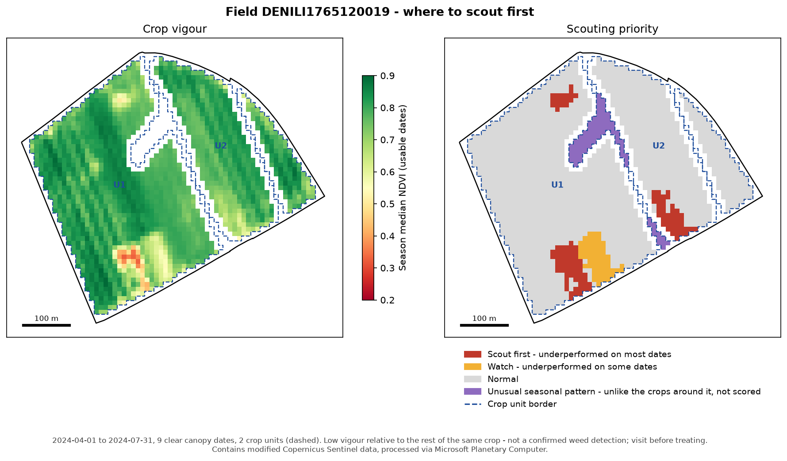

# Precision Weed Scouting — where to look first, from Sentinel-2

[](https://github.com/gowthamuppalapati/Precision-Weed-Detection-and-Targeted-Spraying/actions/workflows/tests.yml)

**Version 1.1.0** · Python ≥ 3.10 · free data only (Sentinel-2 via Microsoft Planetary Computer) · status: calibrated and repeatability-tested, not yet ground-truthed

Give it a field-boundary file and a season. It returns a map of the zones that **underperformed the rest of their own crop on most clear-sky dates**, so a farmer, agronomist or drone knows where to walk first.

It is a **scouting map, not a weed detector.** Sentinel-2 pixels are 10 m wide, so individual weeds and most weed patches are not visible from orbit. Low vigour can come from weeds, but equally from waterlogging, compaction, nutrient deficiency, pests or poor emergence. Every output says this, and each zone carries the evidence behind it ("flagged on 8 of 9 clear dates"). Actual weed detection is the job of v2, a segmentation model on drone imagery (see [Roadmap](#roadmap)).



*Field block DENILI1765120019 near Göttingen, April–July 2024. The block holds two crops (U1 winter cereal, U2 summer crop), and each crop is compared only with itself. Red marks persistent low-vigour zones inside a crop. Purple is a patch whose seasonal curve matches neither crop, so it is shown but not scored. Blank areas inside the field are crop-unit borders and pixels whose crop could not be determined with confidence.*

## Example results (3 official field blocks near Göttingen, 2024 season)

| Field block | Area | Crop units | Usable dates | Scout first | of which at field edge | Watch | Flagged share |
|---|---|---|---|---|---|---|---|
| [DENILI0465750023](outputs/example/DENILI0465750023/summary.md) | 15.7 ha | 1 | 14 | 0.60 ha (3 zones) | 3 | – | 4.3 % |
| [DENILI1765120019](outputs/example/DENILI1765120019/summary.md) | 22.7 ha | 2 | 9 / 6 | 1.34 ha (3 zones) | 2 | – | 8.1 % |
| [DENILI0565200005](outputs/example/DENILI0565200005/summary.md) | 37.5 ha | 3 | 10 / 14 / 12 | 1.64 ha (4 zones) | 4 | 0.34 ha | 6.2 % |

**9 of the 10 Scout-first zones touch the field edge.** On these fields, the strongest persistent signal is the headland, where compaction from turning machinery, hedge shading and overlaps are common. That is real agronomic information, but it is mostly not weeds. If you only want in-crop zones, run with `--edge-buffer-m 20` to leave a wider strip along the edge out of the analysis.

**Not yet validated on the ground.** These zones have not been visited. Until they are, treat the tiers as a prioritised list of places to check, not as findings. The tool generates a [blind field-visit kit](#field-visit-kit) for exactly that.

Maps for the other two fields: [DENILI0565200005](outputs/example/DENILI0565200005/quicklook.png) (three crop units, including a separately sown plot) · [DENILI0465750023](outputs/example/DENILI0465750023/quicklook.png) (one uniform crop; only headland zones flagged).

## How far it has been tested

Full details and reproduction commands: [docs/VALIDATION.md](docs/VALIDATION.md).

| Question | Test | Result |
|---|---|---|
| Does it find a real weak patch? | 480 patches injected into the real 2024 and 2023 Sentinel-2 series of each field | ≥ 0.25 ha patches with a ≥ 15 % NDVI deficit: 83–100 % found as Scout first. 0.1 ha patches or a 5 % deficit: not found |
| Does it flag noise? | Anomaly maps shifted at random so that only chance can line up a zone | ≤ 0.1 % of field area flagged |
| Does it flag too much of a real field? | Share of each real field flagged | ≤ 8.1 % (2024), ≤ 12.2 % (2023) |
| Were the thresholds tuned to fit? | Chosen by a fixed rule on 2024 **and** the held-out 2023 season | The best setting on 2024 alone failed in 2023 and was rejected |
| Are the zones repeatable? | Season split into two independent halves of dates | 73–100 % of Scout-first area found again (chance: 4–15 %) |
| Same zones every year? | 2024 vs 2023 | Mostly not (0–18 %, chance 2–13 %): zones are largely season-specific |
| Is the crop-unit split stable? | Whole split repeated with 5 different random seed sets | 0 %, 2 % and 0 % of pixels scored differently |
| Does it work on a clean machine? | CI: fresh install and full test suite | Linux, Windows, macOS × Python 3.10–3.13 |
| **Are the zones actually weeds?** | **Field visit** | **Not done yet** |

## Project status

| | Status |
|---|---|
| Installs and passes all tests on a clean machine (CI) | ✅ Done |
| Thresholds chosen by a stated rule on real data, checked on a held-out season | ✅ Done |
| Zones repeatable across independent images | ✅ Done |
| Crop-unit split stable across repeated runs | ✅ Done |
| Blind field-visit kit with control points | ✅ Ready to use |
| **Ground-truth visit** (are the zones really weeds or another problem?) | ⏳ Open: needs a visit in a growing season |
| Calibration beyond three fields in one region | ⏳ Open: re-run the calibration on new fields (below) |
| Satellite weed *detection* | ➖ Not possible at 10 m; planned as v2 on drone imagery |

## Quick start

```bash
git clone https://github.com/gowthamuppalapati/Precision-Weed-Detection-and-Targeted-Spraying.git
cd Precision-Weed-Detection-and-Targeted-Spraying
python -m venv .venv && source .venv/bin/activate      # Windows: .venv\Scripts\activate
pip install -e ".[dev]"

weedscout --boundary data/fields/goettingen_example_fields.geojson \
          --start 2024-04-01 --end 2024-07-31 --out outputs/my_run
pytest                                                   # offline tests, no network needed
```

No API key is needed: imagery comes from the free [Microsoft Planetary Computer](https://planetarycomputer.microsoft.com/) STAC API. A run over three fields and one season takes about a minute. The command above reproduces the committed example in [`outputs/example/`](outputs/example/).

### Command-line options

| Option | Default | Meaning |
|---|---|---|
| `--boundary` | required | boundary file; every feature is one field |
| `--start`, `--end` | required | season window, `YYYY-MM-DD`. Include some bare-soil and post-harvest dates: they are what separates crops into units |
| `--out` | `outputs` | output folder; one sub-folder per field |
| `--id-column` | auto | attribute holding the field id (auto: `field_id`, `id`, `flik`, `name`) |
| `--min-zone-ha` | `0.1` | smallest zone that is reported |
| `--edge-buffer-m` | `10` | strip along the field edge left out of the analysis; `20` also leaves out most headland effects |
| `--max-tile-cloud` | `80` | loose pre-filter on whole-tile cloud cover; the field itself is checked pixel by pixel |
| `-v` | off | verbose logging |

Exit code `0` = all fields mapped, `1` = at least one field had too few usable dates, `2` = the boundary file could not be used.

### Field-visit kit

```bash
weedscout-visit-kit outputs/my_run                  # writes outputs/my_run/visit_kit/
weedscout-score-visits outputs/my_run/visit_kit     # after the visit
```

The kit writes one GPS point per zone plus **blind control points** in Normal areas. All points are shuffled and named P01, P02 … so the visitor cannot tell which is which. You get `points.gpx` for a phone GPS app, a `record_sheet.csv` to fill in (weeds none / few / many, other cause, notes, photo), short visit instructions, and a separate answer key. Scoring then reports how often each tier really had a problem **compared with the controls**. A hit rate means nothing without that comparison.

### Recalibrating for your own fields

The default thresholds come from three fields near Göttingen. To check or recalibrate them for other fields, run the same experiments on your own boundary file for two or more seasons, then apply the selection rule:

```bash
python experiments/calibrate.py --boundary my_fields.geojson --start 2024-04-01 --end 2024-07-31 --out experiments/my_2024
python experiments/calibrate.py --boundary my_fields.geojson --start 2023-04-01 --end 2023-07-31 --out experiments/my_2023
python experiments/select_thresholds.py experiments/my_2024 experiments/my_2023
python experiments/reliability.py --boundary my_fields.geojson     # split-half (2024) and 2024-vs-2023 repeatability
```

`select_thresholds.py` prints the setting with the best detection rate that keeps chance false alarms ≤ 1 % and every field ≤ 15 % flagged in every season. Both limits can be changed with `--max-false-alarm` and `--max-flagged`. Each season takes a few minutes for a handful of fields, and the Sentinel-2 data is cached after the first run.

### Project structure

```
src/weedscout/
  boundary.py   read and validate boundary files, choose the UTM zone
  sentinel.py   Sentinel-2 search, reflectance conversion, cloud masking, 10 m field grid
  units.py      split a boundary into crop units: consensus clustering of seasonal NDVI curves
  anomaly.py    per-date anomalies within each crop unit, persistence, tiers, all thresholds
  zones.py      clean tiers, vectorise zones with per-zone statistics
  export.py     COG / GeoJSON / Shapefile / PNG / summary writers
  pipeline.py   one field from boundary to outputs (analyse() is the pure, I/O-free core)
  visit.py      blind field-visit kit and its scoring
  cli.py        the `weedscout` command
experiments/    threshold calibration, selection rule and repeatability experiments on real data
docs/           VALIDATION.md: what was tested and the results
tests/          offline tests on synthetic fields (no network)
data/fields/    example boundaries (official Lower Saxony field blocks)
outputs/example/  committed example run, 2024 season
```

### Input: the boundary files farmers already have

| Format | Notes |
|---|---|
| Shapefile (`.shp` or zipped `.zip`) | needs its `.prj` file; exports from farm-management software work as-is |
| GeoJSON, GeoPackage | any CRS |
| KML | e.g. drawn in Google Earth |
| GPX | a track or route walked around the field edge is closed into a polygon |

Every feature becomes one field. The id comes from `field_id`, `id`, `flik` or `name` (or `--id-column`). Boundaries are repaired if self-intersecting. Anything over 1,000 ha or under 1 ha is rejected with a plain explanation, because neither can be analysed as one field at 10 m resolution.

### Output, per field (`outputs/<run>/<field_id>/`)

| File | What it is | Opens in |
|---|---|---|
| `quicklook.png` | the map above | anything |
| `summary.md` | plain-language result, crop units, and every date with why it was or wasn't used | any text viewer, GitHub |
| `scouting_zones.geojson` | zone polygons with tier, area, persistence, NDVI deficit, `at_field_edge` | QGIS, Google Earth, web maps |
| `scouting_zones_shapefile.zip` | the same zones as a Shapefile | farm-management and sprayer task-controller software |
| `scouting_tiers.tif` | tier raster (Cloud-Optimized GeoTIFF; 0 = no data, 1 normal, 2 watch, 3 scout first, 4 unusual) | QGIS, any GIS |
| `persistence_pct.tif` | % of usable dates each pixel was flagged | QGIS |
| `season_median_ndvi.tif` | median NDVI over usable dates | QGIS |
| `crop_units.tif` | crop unit per pixel (254 = unit uncertain, 255 = unusual pattern) | QGIS |
| `report.json` | everything above plus settings, Sentinel-2 item ids and per-unit NDVI curves, for reproducibility | – |

## Method

1. **Read the boundary** and project it to the field's own UTM zone, taken from the field's location rather than hardcoded.
2. **Load every Sentinel-2 L2A date** in the season onto a 10 m grid aligned with the Sentinel-2 tiles.
   - Convert DN to reflectance **with the −1000 BOA offset** used since processing baseline 04.00 (January 2022).
   - Mask each date with the Scene Classification Layer, keeping only vegetation and bare soil, and grow cloud and shadow masks by 20 m.
   - Merge overlapping tiles from the same day.
   - Drop a 10 m strip along the field edge to remove pixels mixed with roads and hedges.
3. **Split the boundary into crop units.** Official field blocks, and many farm boundary files, can contain more than one crop.
   - Pixels are clustered on their NDVI curve over every clear date of the season (k-means, k = 5, best of 10 runs).
   - Clusters are merged unless their curves **cross**, meaning each one is at least 0.15 NDVI greener than the other on at least 2 dates. Two crops cross because they green up and are harvested at different times. A stressed patch of the same crop follows the same curve, only lower.
   - The whole split is **repeated 7 times with different seeds**, and each pixel takes its majority unit. Pixels without an 80 % majority are left unscored.
   - A **membership check** removes pixels whose own curve crosses their unit's curve. Together with patches under 1 ha that match no neighbouring crop, they are shown as **unusual pattern** and not scored.
4. **Find anomalies within each unit, date by date.** A date is used for a unit only if at least 80 % of the unit is clear and the unit's median NDVI is at least 0.4 (crop canopy present; bare and harvested dates are skipped with the reason logged). A pixel is flagged on a date when it is both
   - a robust outlier: z ≤ −1.5, where z = (NDVI − unit median) / (1.4826 × MAD), and
   - at least 5 % below the unit median, so that a very uniform field cannot turn sensor noise into zones.
5. **Persistence is the confidence.** Each pixel's share of usable dates on which it was flagged gives the tier: ≥ 50 % **Scout first**, ≥ 40 % **Watch**, otherwise **Normal**. A unit with fewer than 3 usable dates gets **no map at all**, with an explanation. A single date cannot separate a persistent problem from a passing one.
6. **Zones:** patches under 0.1 ha are removed, and the rest are vectorised. Statistics are read from the same pixel grid the polygons come from. Each zone records whether it touches the field edge.

The thresholds in steps 4 and 5 were **chosen by a fixed rule, not by hand**. The rule picks the setting that finds the most injected weak patches while keeping chance false alarms ≤ 1 % and every real field ≤ 15 % flagged, in both 2024 and the held-out 2023 season ([docs/VALIDATION.md](docs/VALIDATION.md)). All thresholds are in [`Settings`](src/weedscout/anomaly.py) and [`UnitSettings`](src/weedscout/units.py) and are recorded in every `report.json`.

## Limitations — read before using the map

- **Not ground-truthed.** Nothing here has been checked in the field yet. The calibration measures detection of *synthetic* patches in real data; whether real zones are weeds is unknown until a visit.
- **Cause is unknown.** The map says *where*, never *why*. Weeds are one possible cause among many. On the example fields most Scout-first zones are headland zones.
- **Detection floor of about 0.25 ha.** Patches of 0.1 ha or less, or ones less than about 10 % weaker than the surrounding crop, are not found reliably. Injected patches were uniform over the season; real problems that vary in strength will be found less often.
- **Weeds are only visible when they change the canopy at 10 m scale**, for example dense patches of grass weeds or thistles over many square metres. Scattered weeds under a closed canopy are invisible.
- **Calibrated on three fields in one region over two seasons.** Elsewhere the thresholds may need recalibrating; `experiments/calibrate.py` does that in one command.
- **Field blocks ≠ fields.** The example boundaries are official Lower Saxony *Feldblöcke*, which can hold several farmers' plots. The crop-unit step separates crops with different seasonal curves. Two plots of the same crop sown at the same time cannot be separated.
- **Some ground is left unscored:** crop-unit borders, pixels whose crop is uncertain (1.05 ha in field 1765), and unusual-pattern patches. They appear blank or purple on the map, never as Normal.
- **Cloudy seasons give fewer dates.** In 2024 only 14–16 of 27 Sentinel-2 dates were clear over each field, and fewer still had a crop canopy (6–14 per unit). Persistence over 6 dates is weaker evidence than over 14, which is why `flagged_dates` is reported per zone.

## Roadmap

- **Ground-truth visit** to the example zones, using the blind visit kit. This turns "suspected" into a measured hit rate against control points.
- **Wider calibration:** more fields, crops and regions, so the default thresholds do not rest on three field blocks.
- **Multi-year view:** zones that recur across seasons point to lasting causes and deserve more attention than one-off zones.
- **v2 — weed detection on drone imagery:** a U-Net / DeepLabv3 segmentation model trained on WeedMap / CropAndWeed. The scouting map tells the drone where to fly.
- **Spray-priority dashboard:** FastAPI + MapLibre front-end serving these outputs per field.

## Data and licences

- Sentinel-2 L2A: Copernicus Sentinel data (2023, 2024), via Microsoft Planetary Computer.
- Example field boundaries: Data: © ML/SLA Niedersachsen (2024), [dl-de/by-2-0](https://www.govdata.de/dl-de/by-2-0), Daten bearbeitet. Via [fiboa / Source Cooperative](https://source.coop/fiboa/de-nds).

## Author

**Gowtham Uppalapati** — M.Sc. Sustainable International Agriculture, University of Göttingen & University of Kassel.
